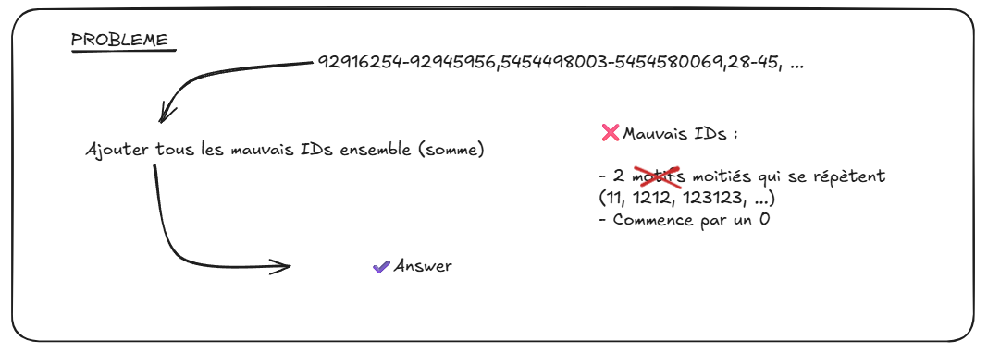

# Day-02 - Remarques sur le code
------------------------



### (1) - Dans chain_input_as_list() la génération du tuple intègre une "compréhension" :
Syntaxe propre à Python permettant d'écrire plus simplement une forme de génération particulière 
Elle s'intègre nécessairement dans une syntaxe qui accepte la compréhension liste[...], tuple(...), etc...

→ Sa forme est : [expression for element in iterable if condition]
→ Se lit : ce qu'on souhaite créer, les éléments parcourus, les conditions pour conserver ces éléments

Equivalent à :

```python
range_list = []

for item in chain.split(","):
    if item.strip():
        range_list.append(item.strip())

range_tuple = tuple(range_list)
```


### (2) - Strip()
Point important à conserver pour le "nettoyage" des caractères vides et retour à la ligne non souhaités
Il s'applique autour des éléments, pas à l'intérieur.

→ Ex.: liste de phrases → plus d'espace ni de \n avant et après chaque phrase


### (3) - Le passage par des tuples permet de sécuriser les effets de bords
→ Une liste est modifiable => partagée entre chaque appel de la fonction
Le procédé : fonction1 retourne tuple → fonction2 le récupère et le repasse en liste sert à ça
On évite de la modifier à chaque appel


### (4) - Première version - is_wrong_id()

Ne répondait pas au problème mais était fonctionnelle :
Récupérait tous les identifiants ayant à l'intérieur au moins 1 motif miroir dans l'ID
Ex. : 4155677 → ...55... récupéré ; 123456 → Ø, non récupéré ; etc...

Principe de la fenêtre glissante à retenir : deux boucles for imbriquées avec slice correspondant à la recherche
Première boucle = fenêtre de lecture (de la plus petite à la plus grande)
Seconde boucle = parcours de la chaîne selon la fenêtre

```python
def is_wrong_id(id_str: str) -> bool:
  id_str = "1234512345"
    # Pour comprendre
    # print("Len ID :"+str(len(id_str)))
    
    for n in range(1, len(id_str) // 2 + 1):        # fenêtre de lecture jusqu'à n de 1 à (len/2 +1) : Si len = 10 → 1, 2, 3 ... 5
        # Pour comprendre
        # print(
        #     f"\n n : {n}"
        #     f"\t i : 0 à {len(id_str) - 2 * n}"
        #     f"\t Comparaison de motifs : {len(id_str) - 2 * n + 1}"
        # )

        for i in range((len(id_str) - 2 * n) + 1):  
            groupe1 = id_str[i:i+n]                 
            groupe2 = id_str[i+n:i+2*n]             
     
            # Pour comprendre
            # print(
            #     f" groupe1 : [{i}:{i+n}]"
            #     f" groupe2 : [{i+n}:{i+2*n}]"
            # )                                        

            if groupe1 == groupe2:
                # print("\nMotif : "+groupe1+groupe2)
                return True
```

#### EXPLICATIONS `is_wrong_id()` v1

> [!TIPS]+ Les commentaires intitulés "Pour comprendre" sont des blocs de code permettant d'afficher le comportement du programme
> Pour les utiliser il suffit de les décommenter puis relancer le script

<br/>
Parcours motif par motif de 0 à (len-2*n+1) : n=1 → i de 0 à 8 ; n=2 → i de 0 à 6 ... n=5 → i=0 seulement

n=1, i=0 : groupe1 = id_str[0:1] ; n=1, i=1 : groupe1 = id_str[1:2] ... n=1, i=8 : groupe1 = id_str[8:9]
n=1, i=0 : groupe2 = id_str[1:2] ; n=1, i=1 : groupe2 = id_str[2:3] ... n=1, i=8 : groupe2 = id_str[9:10]
n=2, i=0 : groupe1 = id_str[0:2] ; n=2, i=1 : groupe1 = id_str[1:3] ... n=2, i=6 : groupe1 = id_str[6:8]
n=2, i=0 : groupe2 = id_str[2:4] ; n=1, i=1 : groupe2 = id_str[3:5] ... n=2, i=6 : groupe2 = id_str[8:10]
...
n=5, i=0 : groupe1 = id_str[0:5]
n=5, i=0 : groupe2 = id_str[5:10]

<br/>

---

#### TESTS DE VERIF


> À rajouter dans la fonction `main()` pour tester
> C'est ce qui m'a permis de vérifier avec l'exemple de AoC 
> → le résultat trouvé ne correspondait pas avec la v1 de `is_wrong_id()`
> 
> Possibilité d'utiliser le fichier d'entrée correspondant à l'exemple du day-02 sur le site AoC : `example_input_d02.txt`

<br/>

```python
    # Pour comprendre
    print(
        f"Liste de plage {chain_input_as_list("input_d02.txt")}"
    )

    # Pour comprendre
    while True:
        id_value = generate_id()
        result = is_wrong_id(str(id_value))
        print(id_value, result)

        if result:
            break

    print("Test nettoyage :", chain_input_as_list(file))

    tests = [
        "11",
        "22",
        "99",
        "1010",
        "58721123",
        "12312345",
        "12345678",
    ]

    for test_id in tests:
        print(f"{test_id:<12} -> {is_wrong_id(test_id)}")
```