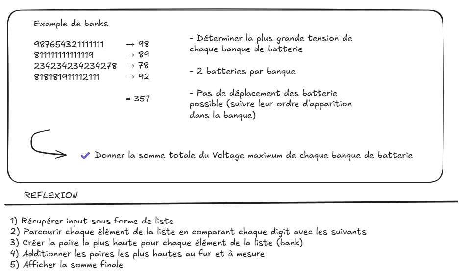

# Day-03 - Récapitulatif des éléments majeurs de ce code




### 1) Récupération concise et efficace en tuple → `comprehension`

La structure de génération de compréhension est très puissante pour récupérer une entrée sous une certaine forme de collection de données (liste, tuple, dictionnaires, objet, ensemble, etc...)

- Récupération avec `open` :

```python
with open(path, "r", encoding="utf-8") as file:
```

- Sa forme est très simple et concise :

```python
mon_tuple = tuple(i
	item.strip()
	for item in file
	if item.strip()
)
```

En 5 lignes de codes pouvant être ramenées à 2 (`with open` + `tuple ( , , )`) on peut donc récupérer et générer une collection de donnée propre selon nos critères.

> Cette structure se lit comme suit :
> "Pour chaque item dans inputs, conserve le résultat de item.strip() uniquement si item.strip() est évalué comme vrai"
> 
> De plus, en Python les chaînes vides sont considérées comme "Fausses" → `strip()` en lève les `espace` et `\n`    
> → ligne qui ne contenait rien à par ça ne sera pas retenue dans le tuple final

### 2) Comparaison 1 caractère avec le reste de chaque chaîne

La structure de boucles imbriquées (*nested loop*) permet très facilement de parcourir une liste ou un tuple de chaînes en détaillant chaque élément (sous-chaînes) et en imbriquant une troisième boucle on peut même les parcourir et comparer 2 à 2 (notre cas ici)

Ainsi on aura une structure du genre :
```python
for item in string_list:
# Parcours de chaque chaîne de la liste
	for index, item in enumerate():
		# Parcours de chaque caractère de chaque chaîne en récupérant sa position
		for i in item[index + 1:]:
			# Parcours de tous les caractères suivants celui de la boucle précédente
```

> [!TIP]
> Ici la forme `for i in item[index + 1:]:` exploitant le slice pour parcourir à partir du caractère retenu au niveau de boucle supérieur est très intéressant et efficace pour une comparaison 2 à 2 avec le reste de la chaîne.
