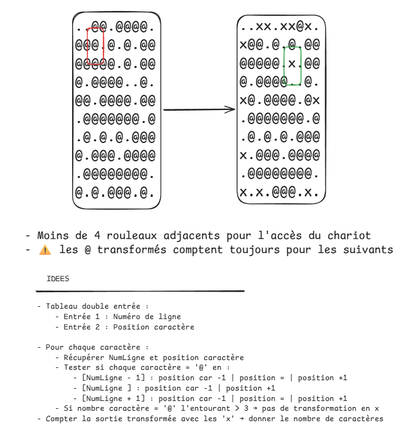

# Day-04 - Récapitulatif des éléments majeurs de ce code



## 1) Exploitation des `expressions génératrice` & `compréhensions`

### Expressions génératrices
Lors de la manipulation des listes ou de listes de chaînes il est intéressant de pouvoir les afficher selon un schéma bien défini : toute la liste, chaque chaîne de la liste, par paquet d'un certain nombre de caractères, etc...

L'utilisation d'expression génératrice permet notamment de parcourir chaque élément d'une liste et d'y réaliser une certaine opération. Celle-ci peut même être envoyé à une autre opération qui compilera l'ensemble des précédente en une seule réponse.

Ex. :
```python
longueur_liste = sum(len(chaine) for chaine in ma_liste)
```

Ici l'expression `len(chaine) for chaine in ma_liste` est interprétée en premier et donne la longueur de chaque chaîne composant la liste.

La partie `sum(...)` va simplement assembler l'ensemble des résultats dans une somme globale.

> [!NOTE]
> Il est aussi possible de se servir d'expression génératrice sous forme de mini-fonctions sauvegardées dans une variable :
> 
> ```python
> longueur = len(chaine) for chaine in ma_liste
> print(longueur)
> # Affichera la longueur de chaque élément de ma_liste[] ligne après ligne
> ```


### Compréhensions

De la même manière, il est possible d'exploiter les compréhension afin de créer un affichage beaucoup plus propre et facilement manipulable.

Par exemple :

```python
# Liste transformée en chaîne unique
chaine = "".join(entry_list)

# Chaîne découpée par paquet de 10 grâce à une compréhension
grille = "\n".join(
	chaine[i:i+10]
	for i in range(0, len(chaine), 10)
)
```

Mettons une liste `entry_list` qui comportait plusieurs chaînes de caractères de tailles variables (sans `\n` ni `' '`)
```
..@@.@@@@.@@@.@.@.@@
@@@@@.@.@@@.@@@
@..@.@@.@@@@.@@.@@@@@@@.@
.@.@.@.@@@@.@@@.@
@@@
.@@@@@@@@.@.@
.@@@.@.
```

Cette forme permettrait d'obtenir un affichage compact et linéaire de 10 caractères par lignes :

```
..@@.@@@@.
@@@.@.@.@@
@@@@@.@.@@
@.@@@@..@.
@@.@@@@.@@
.@@@@@@@.@
.@.@.@.@@@
@.@@@.@@@@
.@@@@@@@@.
@.@.@@@.@.
```

> [!TIPS]
> Les partie intéressantes seraient l'emploi du slice `chaine[i:i+10]` et d'un "pas" dans la boucle `for`
> C'est cette combinaison qui permet de créer une liste de paquets de 10
> La partie `"\n".joint(...)` sert à les regrouper au final en une seule chaîne intégrant des saut de ligne entre chaque paquet de 10


## Analyse des positions adjacentes

Dans ce type d'entrée il était intéressant de pouvoir analyser plusieurs positions situées autour d'un caractère de la "grille" qu'il soit sur une ligne antérieure ou supérieure, sur la même colonne, celle d'avant ou celle d'après. 

Pour ce faire il a fallu employer une première imbrication de boucle :
```python
for numLine, chainItem in enumerate(str_list):
        for idx, posChar in enumerate(chainItem):
	        # posChar représente le caractère en court de lecture 
	        # au sein d'une chaîne de la liste str_list
```

Puis une seconde :
```python
for decalage_ligne in [-1, 0, 1]:
                for decalage_colonne in [-1, 0, 1]:
```

Pour parcourir le tour (les positions adjacentes) de notre caractère.

On respecte ensuite les limites de la grille en vérifiant la position du caractère évalué en fait bien partie :
```python
if (0 <= ligne_voisine < len(str_list)
    and 0 <= colonne_voisine < len(str_list[ligne_voisine])):
```

Puis, une fois sous cette forme il suffit de le comparer avec le caractère de la grille initiale à l'aide de la forme `ma_liste[chaine][caractere]` où :
- `chaine` représente un élément de la liste
- `caractere` représente un élément d'un élément de la liste (d'une chaine)

> [!INFORMATION]
> Bien penser à omettre le caractère en cours de lecture dans l'analyse des positions adjacentes :
> ```python
> if decalage_ligne == 0 and decalage_colonne == 0:
> ```
