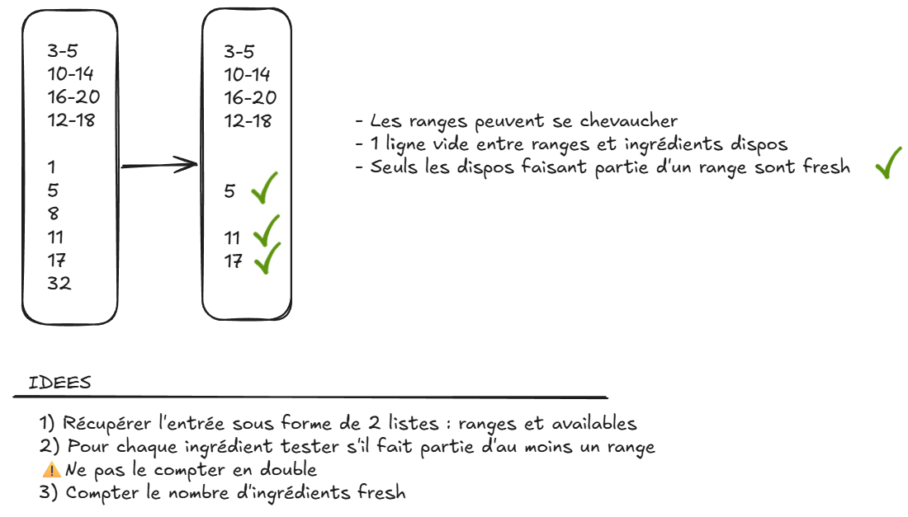

# Day-05 - Récapitulatif des éléments majeurs de ce code



## Déballage de tuples
Les tuples permettent de stocker plusieurs éléments comme les listes, les dictionnaires ou autres collections. Pour accéder à leur contenu il existe plusieurs méthodes :

```python
def ma_fonction():
    liste1 = ["11-22", "95-115"]
    liste2 = ["123", "456"]

    # 1. Retourner plusieurs valeurs sous forme de tuple
    return liste1, liste2 
    # équivaut à return (liste1, liste2)


# 2. Déballer le tuple dans deux variables
liste1, liste2 = ma_fonction()


def traiter(liste1, liste2):
    print(liste1)
    print(liste2)


# 3. Déballer le tuple en arguments positionnels
traiter(*ma_fonction())
# L'opérateur * sert au déballage
# équivaut à :
# traiter(ma_fonction()[0], ma_fonction()[1])
```

Dans notre cas, le déballage positionnel est particulièrement utile pour condenser le code et passer directement les retours d'une fonctions aux arguments d'une autre.

## Listes de chaînes & chaînes
Dans la fonction  `def str_range_limits_to_int(str_range: str) -> tuple(int, int):` j'avais commencé par exploiter directement la liste de ranges puis en simplifiant le raisonnement, seulement chaque élément de la liste, donc des chaînes.
Deux éléments sont ressortis :
→ L'emploi de la chaîne directe est plus simple que de passer par `liste[x].split()`
→ Les méthodes sur les listes et sur les chaînes ne sont pas les mêmes : `split()` ne s'applique pas au liste mais aux chaînes oui

### Docstrings
Nouvel apport : les `docstrings`.
Entourées par `"""` et permettant d'écrire des explications sur plusieurs lignes. Elles permettent de décrire la fonction afin de pouvoir retrouver une explication dans `help(ma_fonction)` de l'interpréteur `python`