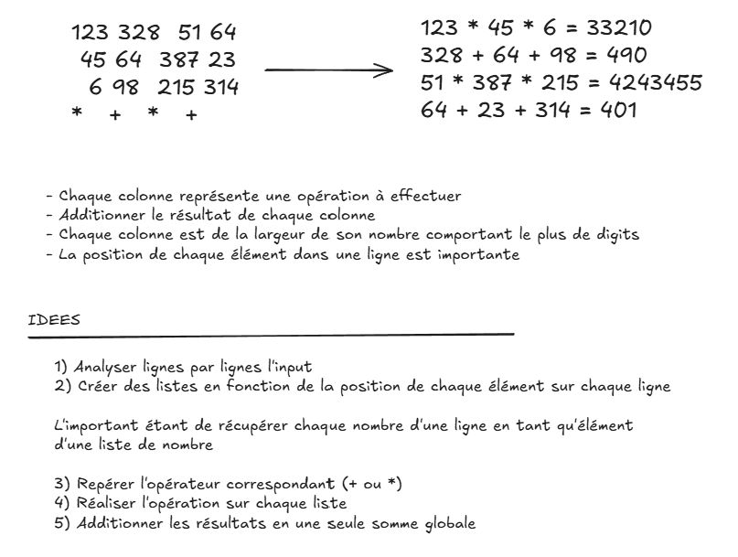

# Day-06 - Récapitulatif des éléments majeurs de ce code



## Récupération d'une Liste de listes de chaînes

Afin de récupérer une liste ligne par ligne où chaque ligne ne contient que les mots (ou ici les numéros et signe d'opération), la méthode la plus efficace est `split()`.

L'écriture suivante de la fonction de collecte nous permet de générer une liste épurée comme souhaité en seulement 3 lignes de code :
```python
# Consultation du fichier
with open(path, "r", encoding="utf-8") as file:
        # Récupération ligne par ligne (dans une liste)
        lines = file.readlines()
	
	# Split() sépare chaque ligne à chaque suite de caractères blancs (espaces, tabulations, retours à la ligne) et transforme la ligne en une liste de chaîne
    return [line.split() for line in lines]
```

## Décalage colonne par colonne sur une ensemble de listes

La forme de boucle imbriquée permet une nouvelle fois de parcourir les sous listes d'une liste primaire.
Ici on commence par récupérer la dernière ligne représentant l'ensemble des opérateurs du fichiers. Ensuite, on se décale opération par opération, ce qui équivaut à se décaler colonne par colonne :

```python
# i représente donc le numéro de colonne
for i, operator in enumerate(operators):
        if operator == "+":
            result = 0
        elif operator == "*":
            result = 1
		
		# Ici on accède à l'élément i de chaque ligne
        for row in numbers_rows:
            if operator == "+":
                result += int(row[i])
            elif operator == "*":
                result *= int(row[i])
```

## Initialiser les opérations à l'élément neutre

Afin de ne pas tronquer chaque somme ou multiplication il est important de les initialiser à la valeur adéquate avant chaque calcul.

Ici on cherche à faire évoluer toujours la même valeur et il faut donc l'initialiser :
- À `0` pour une addition car `x + 0 = x` cette valeur est donc **neutre pour une addition**
- À `1` pour une multiplication (même explication)
	`1*x = x` , cette valeur est neutre pour une multiplication