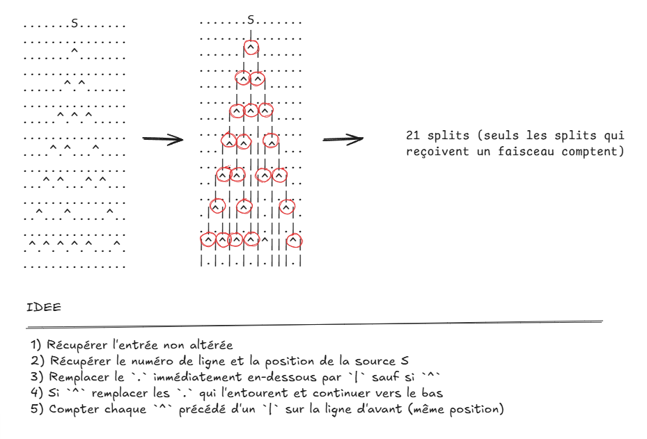

# Day-07 - Récapitulatif des éléments majeurs de ce code



## Extraire des listes de caractères par lignes

Pour manipuler la chaîne de caractères initiale volumineuse aisément il est plus simple de la convertir dans un premier temps en une liste de listes de caractères. Ceci décompose chaque ligne et permet de les parcourir et de les modifier sans problèmes.

```python
with open(path, "r", encoding="utf-8") as file:
        lines = file.readlines()

# Cette ligne convertie en list[] chaque ligne tout en supprimant d'éventuels caractères blanc au début et à la fin
return [list(line.strip()) for line in lines]
```

On obtiendra donc une liste de forme :
```python
list[
	['.','.','.','S','.',...]
	['.','.','.','.','.',...]
	['.','.','.','^','.',...]
	['.','.','.','.','.',...]
	['.','.','^','.','^',...]
	...
]
```

## Optimisation du suivi du faisceau
Ma première approche était d'analyser caractère par caractère en observant celui se trouvant juste en dessous à chaque fois. Cependant, cette méthode est laborieuse et sujette à beaucoup de dédoublements d'opérations à moins de traiter tous les cas particuliers. Elle complexifie grandement la logique du code.

Pour des raisons d'efficacité et de simplicité de raisonnement, il s'est avéré plus intéressant de ne suivre que la position du faisceau. On retrouve donc dans la fonction `trace_beam()` une variable `beam_pos` permettant de référencer la position actuelle du faisceau (sur la ligne en cours de lecture). 
→ Pour définir le comportement du faisceau lors de la rencontre d'un splitter, il suffit de remplacer son contenu par les prochaines positions du faisceau `next_pos`.

Ensuite, pour chaque position, il faudra insérer `|` en s'assurant que le caractère remplacé se trouve bien dans la grille.

```python
# Récupération du point de départ du faisceau
source = input_list[0].index("S")
# Copie propre de la liste
beam = [line.copy() for line in input_list]
# Définition de la position actuelle du fasiceau
beam_pos = {source}

splits = 0

# Parcours des lignes
for num in range(len(beam)-1):
	next_pos = set()
	
	# Parcours des positions du faisceau
	for i in beam_pos:
			if input_list[num+1][i] == "^":
				# Vérification des limites de la grille
				if i-1 >= 0:
					beam[num+1][i-1] = "|"
					next_pos.add(i-1)
				
				# Vérification des limites de la grille
				if i+1 <= len(beam[num + 1]):
					beam[num+1][i+1] = "|"
					next_pos.add(i+1)

				splits += 1
			else:
				beam[num+1][i] = "|"
				next_pos.add(i)
```

> [!TIPS]
> L'utilisation de sets `{}` permet d'éviter de traiter 2 fois la même position qu'on pourrait observer dans le cas ou 2 splitters se suivraient espacés d'une case
> Par ailleurs, les sets sont relativement plus rapides à parcourir que les listes. On optimise donc l'efficacité du code à mesure que l'ensemble des positions grandit